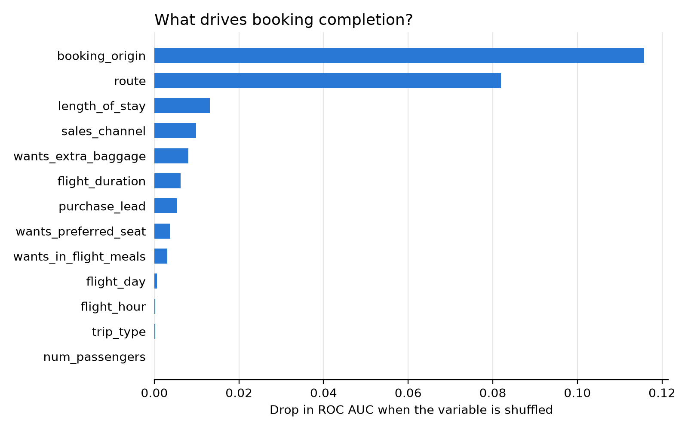
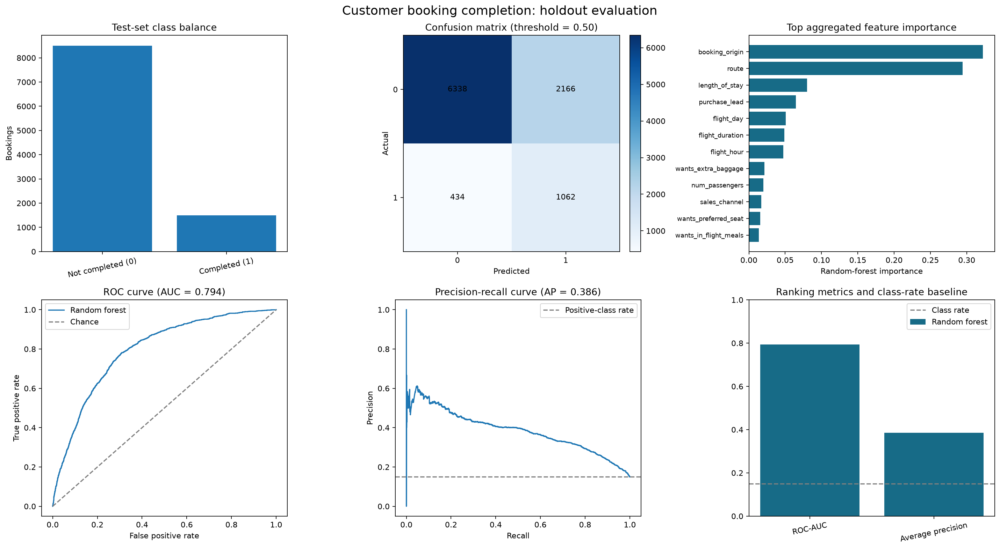

# Task 2 (Machine Learning): Predicting customer bookings

## Problem statement

Customers research and decide on travel long before they reach the airport, so British Airways wants to be proactive and identify likely buyers before they travel. The task is to use customer booking data to predict whether a customer completes a booking, and to judge how predictive the data really is.

The full brief is in [docs/problem_statement.pdf](docs/problem_statement.pdf).

## What the task asked for

1. Prepare the dataset for modeling.
2. Train a machine learning model to predict `booking_complete`.
3. Evaluate the model and show how each variable contributes to its predictive power.
4. Present the findings on a single slide.

## Data

[data/customer_booking.csv](data/customer_booking.csv): 50,000 booking records with 13 input columns and the target `booking_complete` (1 = booking completed).

| Column | Meaning |
| --- | --- |
| `num_passengers` | Number of passengers travelling |
| `sales_channel` | Internet or Mobile |
| `trip_type` | RoundTrip, OneWay or CircleTrip |
| `purchase_lead` | Days between booking and travel |
| `length_of_stay` | Days at the destination |
| `flight_hour`, `flight_day` | Departure hour and day of week |
| `route` | Origin to destination route (799 values) |
| `booking_origin` | Country the booking was made from (104 values) |
| `wants_extra_baggage`, `wants_preferred_seat`, `wants_in_flight_meals` | Optional extras selected (0 or 1) |
| `flight_duration` | Flight length in hours |

## What I did

The full analysis is in [booking_model.ipynb](booking_model.ipynb).

1. **Cleaned the data.** Removed 719 exact duplicate rows, leaving 49,281 bookings, and mapped `flight_day` to numbers.
2. **Checked the target.** Only 15% of customers complete a booking, so the classes are imbalanced. A model that always predicts "no booking" would be 85% accurate, so I did not rely on accuracy.
3. **Explored completion rates by group.** Booking origin shows the widest spread: Malaysia completes 34.5% of bookings and Australia 5.1%.
4. **Prepared the features.** One-hot encoded `sales_channel` and `trip_type`. Target encoded `route` and `booking_origin`, which have too many values for one-hot encoding; the encoding is learned on training data only.
5. **Trained a random forest** (300 trees, `class_weight="balanced"` so the rare "booked" class gets more attention).
6. **Evaluated it** on a stratified 20% test set and with 5-fold stratified cross-validation.
7. **Measured variable importance** with permutation importance: shuffle one column at a time and record the drop in ROC AUC.
8. **Summarised the findings** on [one slide](presentation/booking_model_summary_slide.pdf).

## Results

| Metric | 5-fold cross-validation | 20% test set |
| --- | --- | --- |
| ROC AUC | 0.795 | 0.788 |
| Recall | 0.658 | 0.648 |
| Precision | 0.337 | 0.333 |
| F1 | 0.445 | 0.440 |
| Accuracy | 0.754 | 0.753 |



### Key findings

- **The model ranks bookers well but stays imprecise.** It finds about two thirds of real bookers, but two of every three customers it flags do not book.
- **Booking origin and route carry most of the predictive power.**
- **Flight hour, flight day and number of passengers add almost nothing.**
- **Next step:** add customer-level data such as past bookings, loyalty status and the price shown.

### Script version with a one-hot baseline

[task2_analysis.py](task2_analysis.py) is a standalone script that runs a simpler variant: all categorical columns one-hot encoded, duplicates kept, a single stratified 80/20 split, and a majority-class baseline for comparison. It writes metrics, tables and charts to [reports/](reports/).

| Metric (20% test set) | Random forest | Majority-class baseline |
| --- | --- | --- |
| ROC AUC | 0.794 | 0.500 |
| Average precision | 0.386 | 0.150 |
| Recall | 0.710 | 0.000 |
| Precision | 0.329 | 0.000 |
| Accuracy | 0.740 | 0.850 |

Both variants reach the same conclusion: `booking_origin` and `route` rank first and second, and ROC AUC is about 0.79. Note that this script reports impurity-based importance, which tends to favour columns with many values, so the notebook's permutation importance is the better guide to the smaller variables.



## Limitations

- Importance shows what the model uses to predict; it does not show what causes a customer to book.
- The 0.50 threshold is a reference point, not one tuned to business costs.
- The data has no customer history, so the model cannot tell a loyal customer from a first-time visitor.

## Reproduce

From the repository root:

```bash
python -m pip install -r requirements.txt

# Notebook: run from inside this folder so it finds data/customer_booking.csv
cd task2-machine-learning-booking-prediction
jupyter notebook booking_model.ipynb

# Script version
python task2-machine-learning-booking-prediction/task2_analysis.py
```
